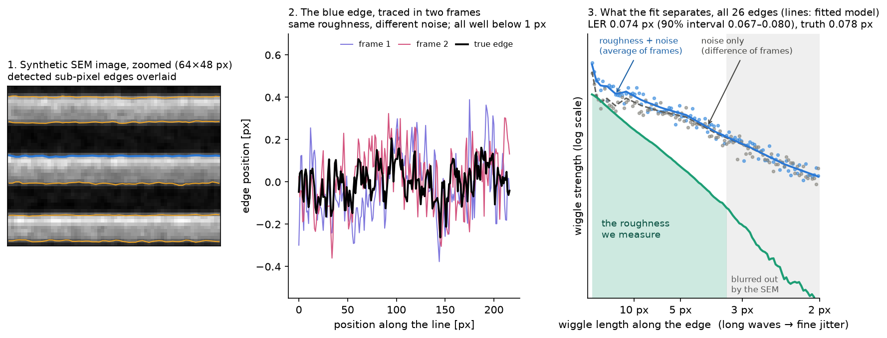
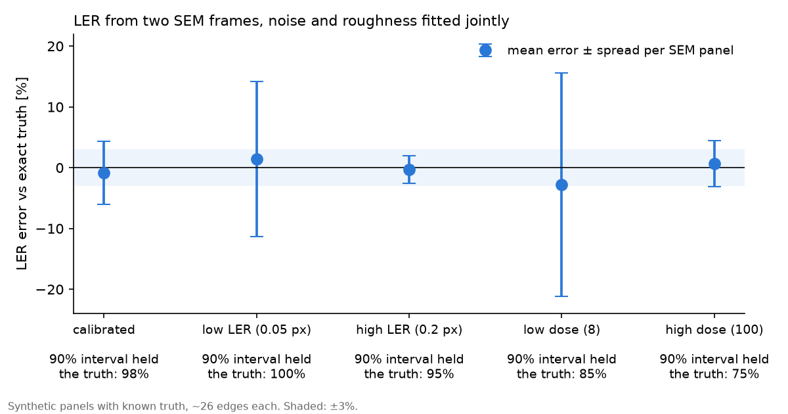

# Sub-pixel randruwheid van lijnen uit twee SEM-frames

De randruwheid (line-edge roughness, LER) van resistlijnen is vaak even groot als de ruis van de
SEM: een groot deel van de gemeten randvariatie is ruis. Dit project schat de werkelijke LER uit
twee frames van hetzelfde gebied door ruis en ruwheid samen te fitten met een Whittle-likelihood
(in het frequentiedomein), en test dat op synthetische SEM-beelden waarvan de echte randen exact
bekend zijn.



## Methode

1. **Synthetische data** (`lerwhittle/synth.py`): ruwe lijn/ruimte-geometrie
   (Palasantzas-ruwheidsspectrum, variatie in CD en positie tussen lijnen), SEM-beeldvorming
   (randoplichting, bundelvervaging, pixelintegratie) en ruis (schot-, uitlees- en scanlijnruis,
   vervaging na de ruis, 8 bit), twee keer afgebeeld met onafhankelijke ruis. De standaardwaarden
   zijn gekalibreerd op een echt SEM-beeld van lijnen en ruimtes.
2. **Randen** (`lerwhittle/edges.py`): elke kolom van elke rand wordt vergeleken met een ruisvrij
   gesimuleerd randprofiel (met vrije versterking en offset). Dat geeft randposities op
   sub-pixelniveau, zonder de pixel-locking van drempeldetectie.
3. **Gezamenlijke Whittle-fit** (`lerwhittle/whittle.py`): per rand bevat het gemiddelde van de
   twee frames ruwheid + ruis, hun verschil alleen ruis, met hetzelfde ruisspectrum. Beide
   periodogrammen gaan in één likelihood:

   ```
   verschil:    I_d(f) ~ Exp( N(f) )
   gemiddelde:  I_s(f) ~ Exp( LER² · H²(f) · P(f; ξ, H) + N(f) )
   ```

   P is een Palasantzas-ruwheidsspectrum, H² de gesimuleerde overdracht van beeldvorming plus
   randdetector, N een ruisspectrum dat vrij is op een reeks frequentiepunten (zonder aangenomen
   vorm). Het 90%-interval volgt uit de profiel-likelihood, waarbij alle andere parameters
   opnieuw gefit worden.

De LER binnen de band (de frequenties die de vervaging doorlaat) is de robuuste grootheid; de
volledige pixel-LER extrapoleert het gefitte spectrum boven de vervagingsgrens.

## Resultaten

`python benchmark.py`: per beeld (~26 randen) de fout ten opzichte van de exacte waarheid
(gemiddelde ± spreiding) en hoe vaak het 90%-interval de waarheid bevatte.

| Conditie | Beelden | LER-fout | 90%-interval klopte | Fout LER binnen band | 90%-interval klopte |
|---|---|---|---|---|---|
| Gekalibreerd | 40 | −0,9% ± 5,2% | 98% | −1,3% ± 4,7% | 98% |
| Lage LER (0,05 px, 5× onder de ruis) | 20 | +1,4% ± 12,8% | 100% | −0,1% ± 12,9% | 95% |
| Hoge LER (0,2 px) | 20 | −0,3% ± 2,3% | 95% | −0,7% ± 1,7% | 100% |
| Lage dosis (1/3 van de elektronen) | 20 | −2,8% ± 18,4% | 85% | −4,3% ± 15,0% | 85% |
| Hoge dosis (4× de elektronen) | 20 | +0,6% ± 3,8% | 75% | +0,3% ± 2,8% | 95% |



`python benchmark.py --shapes` herhaalt dit voor ruwheid die *niet* de Palasantzas-vorm heeft
(een extra component op lange schaal, een periodieke piek, een Gaussisch spectrum): de LER binnen
de band blijft gemiddeld binnen 1,3% (gekalibreerde beeldvorming, 20 beelden per vorm); de
geëxtrapoleerde LER hangt af van de aangenomen vorm (+3,3% voor het Gaussische spectrum, dat geen
machtswetstaart heeft).

## Gebruik

```
pip install -r requirements.txt
python benchmark.py               # ~10 min
python figures.py
python generate_data.py 10 data   # synthetische beelden (PNG) met hun exacte randen wegschrijven
pytest
```

## Beperkingen

- Alleen synthetische data, gekalibreerd op één echt beeld. Echte data met twee frames brengt ook
  drift, oplading en krimp van de resist tussen de frames mee; die zijn niet gemodelleerd.
- Vereist twee frames van hetzelfde gebied (bijvoorbeeld de even en oneven frames van één
  gemiddelde opname).
- De bibliotheek met randprofielen en de randoverdracht gaan uit van een bekend, gekalibreerd
  beeldvormingsmodel.
